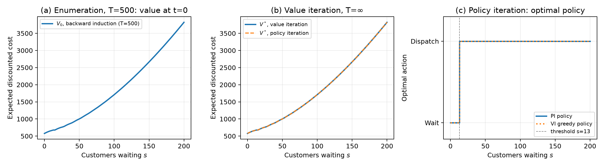
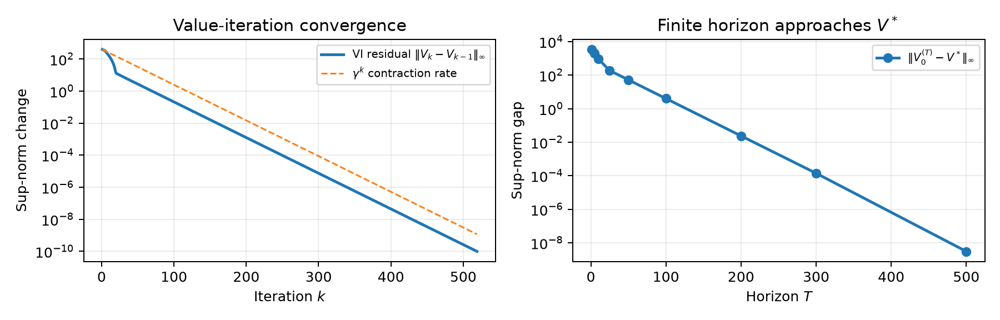
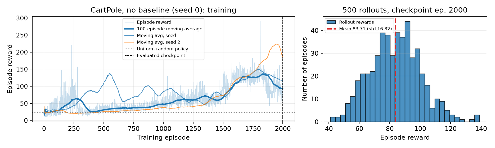
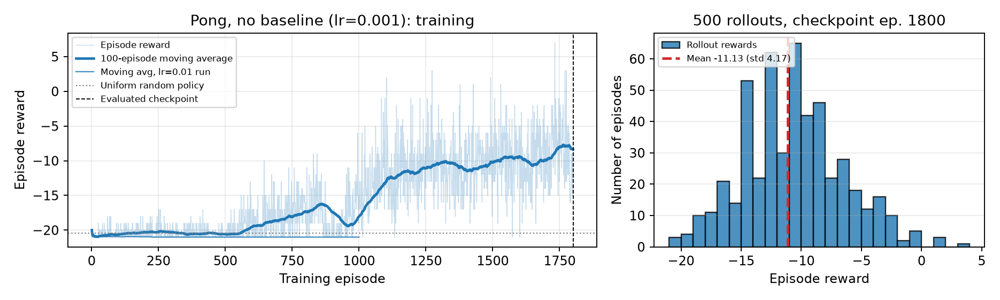
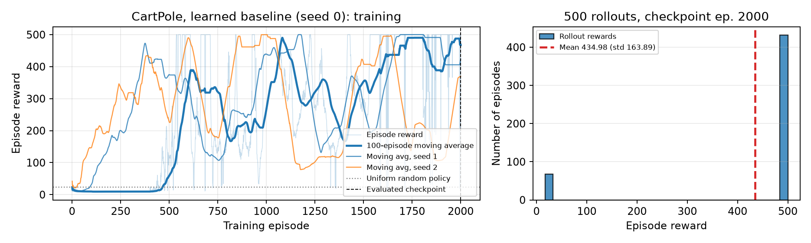
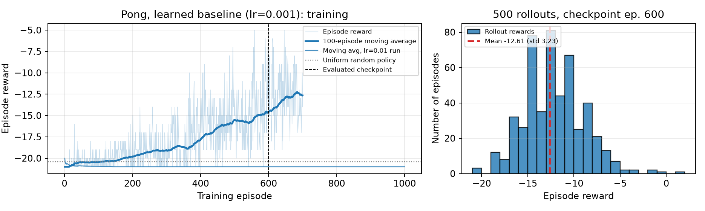
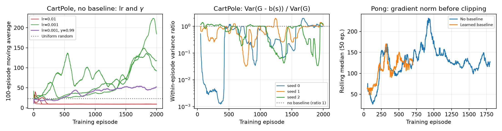

# 0. Reproducing the results

All code is in `https://github.com/fxiong3/mlds-assignment1-rl`. Dependencies are pinned in `pyproject.toml`/`uv.lock`. Training ran on Northwestern's DeepDish server (Python 3.10.12, PyTorch 2.6.0+cu124, Gymnasium 1.2.3, ale-py 0.11.2, one RTX A6000); DP and plotting run on a laptop. The test suite (50 tests, 82% line coverage) passes on DeepDish.

```
uv sync --extra dev && .venv/bin/AutoROM --accept-license    # environment + Pong ROM
.venv/bin/pytest                                              # unit tests
./scripts/run_dp.sh && PYTHONPATH=src python scripts/dp_validation_extra.py     # Question 2
.venv/bin/mlds-train --config configs/<name>.yaml --seed <s> --device cuda      # Question 3
python scripts/parallel_evaluate.py --checkpoint checkpoints/<run>-episode-<n>.pt --episodes 500
python scripts/make_pg_figures.py                              # all PG figures in report/figures
```

Configs used: `cartpole_no_baseline_lr001.yaml`, `cartpole_baseline.yaml`, `pong_no_baseline_tuned.yaml`, `pong_baseline_tuned.yaml` (plus the lr = 0.01 configs for the comparisons). Raw per-episode CSVs, evaluation CSVs and JSON summaries are under `results/`.

# 1. Question 2: shuttle dispatch

## 1.1 Model and assumptions

State $s\in\{0,\dots,200\}$ is the number of people waiting when the decision is made. Action $a\in\{0,1\}$ (wait, dispatch). Within one period the order of events is: decide, the shuttle leaves with $\min(s,K)$ people, holding cost is charged on the people left behind, then $A_t\sim\mathrm{Unif}\{1,\dots,5\}$ arrive. So

$$c(s,a)=c_f\,a + c_h\,(s-Ka)^+,\qquad s' = \min\{200,\,(s-Ka)^+ + A_t\},$$

with $K=15$, $c_f=100$, $c_h=2$, $\gamma=0.95$, and we minimise expected discounted cost. Further assumptions:

* **Cap at 200.** Any arrival that would push the queue above 200 is absorbed into state 200 (those customers are not lost from the cost, they are simply not counted beyond 200). The transition rows still sum to one. At $\gamma=0.95$ the optimal policy never lets the queue get near 200, so the cap only matters for values near the top of the grid.
* **Dispatching at $s<K$** is allowed and empties the queue; dispatching at $s=0$ costs 100 and does nothing.
* **Finite horizon:** terminal value $V_T\equiv 0$; $V_t(s)=\min_a\{c(s,a)+\gamma\,\mathbb E V_{t+1}(s')\}$, solved by backward induction over all 201 states and both actions ("enumeration").
* **Value iteration** starts at $V\equiv0$ and stops when $\|V_k-V_{k-1}\|_\infty<10^{-10}$. **Policy iteration** starts from "always wait", evaluates each policy exactly by solving $(I-\gamma P_\pi)V=c_\pi$, and stops when the greedy policy no longer changes. Ties go to "wait".

## 1.2 Results

{width=100%}

The optimal policy is a threshold rule: **wait while $s\le 12$, dispatch when $s\ge 13$**. The finite-horizon policy at $t=0$ and both infinite-horizon methods give the same threshold. $V^*(0)=576.67$ and $V^*(200)=3821.59$. Value grows roughly quadratically in $s$, because a long queue takes several dispatches to clear and holding cost is paid on everyone still waiting. There is a visible kink at $s=13$: for $13\le s\le15$ dispatching empties the queue, so $V^*(13)=V^*(0)+100$ exactly (same next-state distribution, plus the dispatch fee). This identity holds in the computed values to machine precision.

## 1.3 Edge cases

| Edge case | Handling | How it was checked |
|---|---|---|
| Queue would exceed 200 | Overflow probability added to state 200 | Unit tests: every row of $P_a$ sums to 1; from $s=200$ with wait, all mass stays at 200 |
| $s<K$ with dispatch | Remaining $=(s-K)^+=0$, no negative states | Unit test of $c(s,a)$ (dispatch fee + post-dispatch holding); unit test that the empty queue is never dispatched |
| Last decision period ($T$) | $V_T=0$, so last-stage policy is myopic | With $T=1$, $V_0(s)=\min(2s,\,100+2(s-15)^+)$ matches the hand formula exactly (max gap 0.0); the one-step policy never dispatches, as expected |
| Ties between actions | `argmin` picks wait | VI and PI policies agree in all 201 states, so no tie was broken differently |
| Non-convergence | VI/PI raise an error after a max iteration count | Never triggered; VI took 519 iterations and PI took 6 |

## 1.4 Validation tests (RL-level, not unit tests)

Everything below comes from `scripts/dp_validation_extra.py` and `mlds-dp` (outputs in `results/dp/*.json`).

1. **Three methods agree.** $\max_s|V_{VI}-V_{PI}|=1.9\times10^{-9}$, policy disagreements $=0$, and $\max_s|V_0^{(500)}-V_{VI}|=3.1\times10^{-9}$. Pass criterion: below $10^{-6}$.
2. **Convergence behaves as theory predicts** (Figure 2). The VI residual falls along the $\gamma^k$ line, which is what a $\gamma$-contraction should do. The gap $\|V_0^{(T)}-V^*\|_\infty$ is 3422, 917, 52, 4.0, 0.024 for $T=1,10,50,100,200$, shrinking roughly like $\gamma^T$. PI's Bellman residual reaches $9\times10^{-13}$ after 6 improvement steps.
3. **Hand / brute-force check.** With deterministic arrivals ($A_t\equiv3$) and $T=10$, I enumerated all $2^{10}$ action sequences from every start state $0\dots40$ and compared the best one with backward induction. The largest gap is $1.7\times10^{-13}$.
4. **Monte Carlo check of $V^*$.** I simulated the optimal policy for 1000 episodes × 500 steps from $s\in\{0,50,100,150,200\}$. Every empirical mean is within one standard error of the predicted value (e.g. $s=100$: predicted 1709.04, simulated 1708.47 ± 1.40).
5. **Threshold structure and comparative statics.** The policy is monotone (wait below, dispatch above) in every setting I tried, and the threshold moves in the direction intuition predicts:

| Changed parameter | Values $\to$ threshold | Expected direction |
|---|---|---|
| $c_f$ | 50 $\to$ 11, 100 $\to$ 13, 200 $\to$ 14, 400 $\to$ 15 | dearer dispatch $\Rightarrow$ wait longer, but never past $K$ (waiting beyond 15 wastes capacity) |
| $c_h$ | 1 $\to$ 14, 2 $\to$ 13, 4 $\to$ 11 | dearer waiting $\Rightarrow$ dispatch earlier |
| $K$ | 10 $\to$ 9, 15 $\to$ 13, 20 $\to$ 16 | bigger bus $\Rightarrow$ worth filling more |
| $\gamma$ | 0.5 $\to$ never, 0.9 $\to$ 13, 0.95 $\to$ 13, 0.99 $\to$ 13 | myopic agent: 100 now is not worth $\approx 2\cdot15$ saved per period over ~2 effective periods |

{width=82%}

# 2. Question 3: policy gradient

## 2.1 Implementation

REINFORCE in PyTorch with Adam. After each episode I compute the discounted reward-to-go $G_t=\sum_{k\ge t}\gamma^{k-t}r_k$ and minimise $-\sum_t \log\pi_\theta(a_t|s_t)\,G_t$. Using $G_t$ instead of $G_0$ at every step is the usual causality trick: it gives an unbiased estimate of the gradient of the episode's discounted return with lower variance. Like most implementations, I drop the $\gamma^t$ weight in front of each term. Returns are **not** normalised in Part 1, so Part 1 has no implicit baseline. Gradients are clipped at norm 10, and the logged gradient norm is the value before clipping.

* **CartPole-v1**, $\gamma=0.95$: MLP $4\to128\to2$ (ReLU), 2000 training episodes, episodes capped at 500 steps.
* **Pong-v5** (`ALE/Pong-v5`, default frameskip 4 and sticky actions 0.25), $\gamma=0.99$: each frame goes through the given 80×80 preprocessing. The network sees the current and previous processed frames stacked as 2 channels (conv 8×8/4 $\to$ conv 4×4/2 $\to$ FC 256). The output is a 2-way softmax mapped to environment actions **2 (RIGHT) and 3 (LEFT)** only. Episodes are capped at 10,000 agent steps.
* **Learning rate.** The specified lr = 0.01 was run first for all four experiments. It works for CartPole with a baseline, but CartPole without a baseline and both Pong runs **collapsed to a deterministic policy** (Section 2.5). The reported no-baseline CartPole run and both Pong runs therefore use **lr = 0.001**. The lr = 0.01 runs are kept as a validation result.
* **Evaluation.** After training, the frozen policy plays 500 episodes, sampling actions from $\pi_\theta$ (not argmax), with fixed per-episode seeds. The 500 episodes are split across CPU workers (`scripts/parallel_evaluate.py`); each episode keeps the same seed it would get in the sequential evaluator. Evaluation of the final Pong checkpoints ran on CPU on a less loaded DeepDish node; the Pong baseline run was moved from GPU (deepdish4) to CPU (deepdish1) at episode 300 using the checkpoint/resume mechanism, which restores model, optimiser and RNG state.

## 2.2 Part 1 (no baseline)

{width=100%}

| no baseline, lr 0.001 | seed 0 | seed 1 | seed 2 | uniform random |
|---|---|---|---|---|
| 500-episode mean ± std | 83.7 ± 16.8 | 147.6 ± 20.0 | 146.4 ± 11.3 | 23.0 ± 11.7 |

Without a baseline, CartPole learns (4–6× random) but slowly and unevenly. The moving average oscillates between about 50 and 220, and no seed reaches 500 within 2000 episodes.

{width=100%}

For roughly the first 700 episodes the Pong agent hardly beats random play (moving average about −20.5). After that it improves steadily: −17.3 at episode 800, −11.6 at 1200 and −8.4 at 1800. Games also get much longer, from about 1,000 agent steps to about 5,000, because the agent now returns the ball. **Evaluation (checkpoint at episode 1800, 500 games): mean −11.13, std 4.17**, best game +3. That is about 9 points per game better than random (−20.43 ± 0.80). The episode-1500 checkpoint, evaluated the same way, scored −10.00 ± 3.55. The later checkpoint is not better, even though the training moving average kept rising (−9.4 at 1600, −8.4 at 1800). So with one seed, the last few hundred episodes are mostly noise around −10. Training was planned for 3000 episodes but was stopped at episode 1800 to meet the submission deadline; at ~12 s per episode, finishing would have taken several more hours.

## 2.3 Part 2 (learned state-value baseline)

**Choice.** I used a **non-constant, learned baseline** $b(s)=V_\phi(s)$. It is a second linear head on the same trunk as the policy and is trained with $0.5\cdot\mathrm{MSE}(V_\phi(s_t),G_t)$ in the same Adam step. The policy term uses $A_t=G_t-V_\phi(s_t)$ with $V_\phi$ **detached**, so the value loss cannot change the policy gradient through the advantage (a unit test checks this gradient separation). Because $b$ depends only on $s_t$, the gradient estimate stays unbiased.

{width=100%}

| baseline, lr 0.01 | seed 0 | seed 1 | seed 2 |
|---|---|---|---|
| 500-episode mean ± std | 435.0 ± 163.9 | 500.0 ± 0.0 | 155.7 ± 7.0 |
| first episode with moving avg $\ge$ 195 | 556 | 243 | 120 |

At the same lr = 0.01, the no-baseline runs never left ~9 steps per episode, while all three baseline runs passed 195 within 560 episodes and one is perfect (500/500 in all 500 rollouts). Seed 0's histogram is bimodal: 433 episodes reach 500 and the rest fail early. Seed 2's final checkpoint fell from a moving average of ~490 to 370 just before training ended, which is why its evaluation is lower. Late-training instability like this is typical of plain REINFORCE at lr = 0.01. Saving the best checkpoint instead of the last one would hide it, but I report the last checkpoint.

{width=100%}

| Pong, lr 0.001, moving avg at episode | 200 | 300 | 400 | 500 | 600 |
|---|---|---|---|---|---|
| no baseline (seed 1) | −20.3 | −20.3 | −20.6 | −20.6 | −19.5 |
| learned baseline (seed 2) | −19.8 | −19.1 | −17.8 | −15.5 | −14.6 |

At equal training budgets the baseline run improves much earlier. Its moving average first rises above −18 at episode 391, against 737 without the baseline. By episode 600 it is about 5 points ahead. **Evaluation (checkpoint at episode 600, 500 games): mean −12.61, std 3.23, best game +1.** This checkpoint has seen only 600 training episodes, against 1800 for the no-baseline checkpoint. Even so, it scores within 1.5 points of it. The fair comparison is the table above, at matched episode counts. This is one seed per arm, and some of the gap could be seed luck. The CartPole results, with three seeds, are the stronger evidence for the baseline.

## 2.4 Edge cases (both parts)

| Edge case | Handling | Check |
|---|---|---|
| `terminated` vs `truncated` (CartPole 500-step limit, Pong step cap) | Loop stops on either; no bootstrapping, so a truncated episode is treated as ending there | Evaluation lengths never exceed 500 (CartPole); the cap is recorded in the config |
| Pong has 6 actions but only 2 are allowed | Policy outputs 2 logits; `map_policy_action` maps 0 $\to$ 2, 1 $\to$ 3 and raises on anything else | Unit test; trace logs show environment actions only in {2, 3} |
| First Pong frame has no "previous" frame | Previous frame is set to zeros | Unit tests: preprocessing matches the assignment definition and rejects wrong shapes; network output shapes |
| Very long Pong episodes on GPU | Observations kept on CPU; log-probs recomputed in batches of 256 so the autograd graph stays bounded | 5000+-step episodes trained with no out-of-memory errors for 4+ hours |
| Constant returns (advantage std = 0) | Optional normalisation returns zeros instead of dividing by 0 | Unit test |
| Saturated softmax ($\pi\to$ one-hot) | Not prevented (no entropy bonus); detected through logs | Gradient norm drops to exactly 0, see 2.5 |
| Interrupted runs | Checkpoints every 100 episodes store model, optimiser and RNG state; `--resume` | Unit test: a resumed run reproduces uninterrupted training exactly |

## 2.5 Validation tests

{width=100%}

1. **Random-policy reference.** Run with `mlds-validate random`, 500 episodes each. CartPole uniform random scores 23.0 ± 11.7 and Pong random scores −20.43 ± 0.80. A trained policy only counts as learned if it beats these by many standard errors. All lr = 0.001 CartPole runs (84–148) and the Pong runs reported above pass. The lr = 0.01 no-baseline CartPole runs (9.35 ± 0.79) fail: they are *worse* than random.
2. **First 10 steps by hand** (`*-trace.json`, written for the first training episode). CartPole seed 0: actions are near 50/50 ($\pi\approx0.51/0.49$), every reward is 1, and $G_9=10.247$, $G_8=10.734=1+0.95\cdot10.247$, so the recursion checks by hand. Pong: rewards are 0 for the first 10 steps and $G_t$ grows by exactly a factor $1/0.99$ going backwards ($-1.089, -1.100, -1.111,\dots$). Environment actions are only 2 and 3.
3. **Learning-rate test (diagnosing the collapse).** With lr = 0.01 and no baseline, all three CartPole seeds converge to ~9-step episodes. The median gradient norm over training is **exactly 0**: the softmax is saturated, the sampled action has probability $\approx$ 1, and $\nabla\log\pi=0$, so the agent can never recover. Pong at lr = 0.01 shows the same thing: every evaluation game ends 0–21 after exactly 764 steps, i.e. the paddle is stuck in one action. The reason is that all CartPole rewards are positive, so without a baseline every sampled action is reinforced, and a large step size locks in whatever was sampled early. Dropping to lr = 0.001 fixes it (left panel, green).
4. **Discount-factor test.** With $\gamma=0.99$ (lr = 0.001, otherwise identical), CartPole learns more slowly than with $\gamma=0.95$ (purple line, left panel). This is expected: the return now sums ~100 future rewards instead of ~20, so its variance is higher and the credit signal is weaker.
5. **Baseline reduces variance.** Middle panel: over long stretches of training, $\mathrm{Var}(G_t-V_\phi(s_t))$ within an episode is 3–30× smaller than $\mathrm{Var}(G_t)$. While seed 0 was stuck in 9-step episodes the ratio fell to $10^{-3}$, because the value head fitted those returns almost perfectly. The ratio goes back towards 1 when the policy changes faster than the critic can follow. In Pong the picture is different. Over episodes 100–600 the per-episode advantage variance with the baseline (median 0.33) is not smaller than the return variance (0.29), and the gradient norms are similar (median 115 vs 109, right panel). With rewards only every few hundred frames, the value head has not yet learned to predict the return. The faster learning in Pong therefore cannot be credited to variance reduction from this measurement alone.
6. **Reduced randomness.** Acting greedily (argmax) with the CartPole baseline seed 0 checkpoint gives 481.0 ± 93.2 over 50 episodes, versus 435.0 ± 163.9 when sampling. Most of the evaluation spread comes from sampling noise in the policy, not from a bad mean policy.
7. **Several seeds.** CartPole has 3 seeds per setting and the conclusions hold for all of them. Pong has one seed per setting because of compute, so its comparison is suggestive, not conclusive.

**Pass criteria.** (1) beat random by more than 5 standard errors; (2) exact agreement with the hand recursion; (3)–(4) the direction of change matches theory; (5) ratio < 1 on average after warm-up; (6) greedy $\ge$ sampled.

# 3. With three more months

* **More seeds and confidence intervals.** 10+ seeds per setting, bootstrap CIs on final performance and on "episodes to solve", and a permutation test for baseline vs no baseline. Right now Pong has n = 1 per arm.
* **Train Pong to convergence** ($\ge$ 5000 episodes per run, ~10 h each) and re-evaluate. Add a learning-rate sweep {3e-4, 1e-3, 3e-3} and an entropy bonus to rule out the collapse in 2.5(3) more cleanly.
* **Direct gradient-variance measurement.** Freeze a policy, draw 200 independent episode gradients with and without the baseline, and compare the trace of the empirical covariance. Logged norms only approximate this.
* **Other baselines:** constant (running mean of $G$), learned $V_\phi$ with a separate network, and actor-critic/GAE($\lambda$), all at matched compute.
* **DP:** an analytic proof that the policy is a threshold rule (show $V$ is convex in $s$), a cap-sensitivity study (200 vs 400), non-uniform arrival distributions, and a check that the optimal threshold maximises simulated long-run reward.
* **Reproducibility:** rerun everything from a clean clone on a second machine, compare the curves, and add a CI job that runs the short smoke tests.
